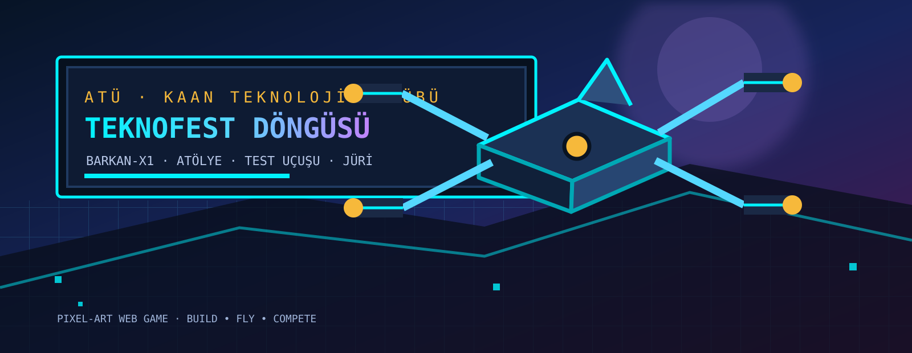

  

<h1 align="center">Kaan Teknoloji Kulübü: TEKNOFEST Döngüsü</h1>

  ATÜ Kaan Teknoloji Kulübü'nün atölye kültürünü, İHA geliştirme sürecini ve TEKNOFEST heyecanını pixel-art bir tarayıcı oyununa dönüştüren interaktif deneyim.

  
  
  

## Proje hakkında

Oyuncu, **Kaptan Burka** olarak BARKAN-X1'i geliştiren bir İHA takımını yönetir. Kısıtlı bütçe, zaman ve moral arasında doğru kararları vererek atölyeden jüri sunumuna kadar ilerler.

Bu proje; öğrenci takım hayatındaki üretim, AR-GE, uçuş testi, ekip koordinasyonu ve yarışma atmosferini mizahi bir dille canlandırır. Resmî bir TEKNOFEST ürünü veya simülatörü değildir.

## Oyunda neler var?

- 🔧 **Atölye yönetimi:** gövde, otopilot ve batarya geliştirmeleri
- 🛸 **BARKAN-X1 test uçuşu:** kapı geçişleri, QR hedefi, kargo bırakma ve FPV modu
- 🧬 **Kalıcı AR-GE sistemi:** XP ile güçlenen yetenek ağacı
- 🎪 **Festival alanı ve jüri:** pist hazırlığı, takım kararları, puanlama ve liderlik tablosu
- 🕵️ **Mini oyunlar:** atölye gezintisi, gece hurdalığı operasyonu ve sürpriz etkinlikler
- 📱 **Kulüp sosyal medyası:** gönderiler, vlog ve takipçi sistemi
- 📱 **Mobil uyum:** dokunmatik kontrol düğmeleri ve duyarlı arayüz

## Kontroller

| Ekran | Kontroller |
| --- | --- |
| Test uçuşu | `W/S` gaz ve iniş · `A/D` yön · `Boşluk` kargo bırak |
| FPV | `C` |
| Atölye / mini oyunlar | Ekrandaki butonlar ve ilgili klavye ipuçları |
| Mobil | Oyun içindeki dokunmatik tuşlar |

## Çalıştırma

Bu proje bağımsız bir statik web uygulamasıdır; kurulum veya derleme gerekmez.

1. Repoyu indir veya klonla.
2. `index.html` dosyasını modern bir tarayıcıda aç.
3. Atölyeden BARKAN-X1'i geliştir ve TEKNOFEST yolculuğunu başlat.

> En iyi deneyim için Chrome, Edge veya Firefox'un güncel sürümünü kullanın. Fontlar ve Tailwind CSS, CDN üzerinden yüklenir.

## Teknik yapı

- Tek dosyalı HTML/CSS/JavaScript mimarisi
- Canvas tabanlı sahneler ve mini oyunlar
- Tailwind CSS CDN
- Google Fonts: Press Start 2P ve VT323
- Oyun ilerlemesi için tarayıcı içi durum yönetimi

## Ekran atmosferi

  

## Katkı

Fikir, hata bildirimi ve iyileştirme önerileri için bir issue açabilirsin. Kod katkılarında mevcut görsel dilin, Türkçe metinlerin ve tek-dosya yapısının korunması tercih edilir.

---

  <b>ATÜ Kaan Teknoloji Kulübü</b> · Tasarım ve geliştirme: <a href="https://github.com/BurkaX-0">BurkaX-0</a>

